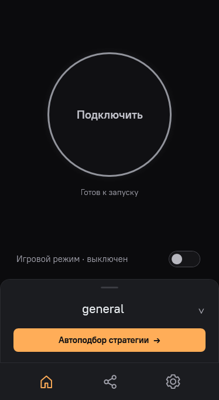
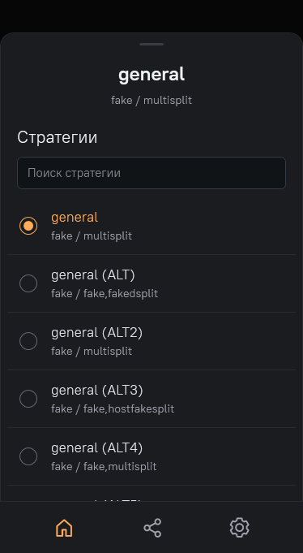
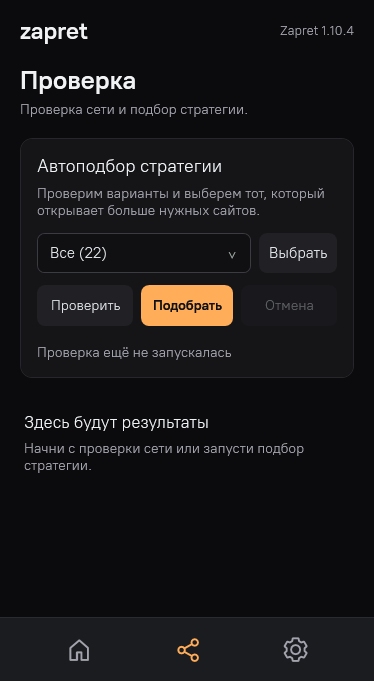
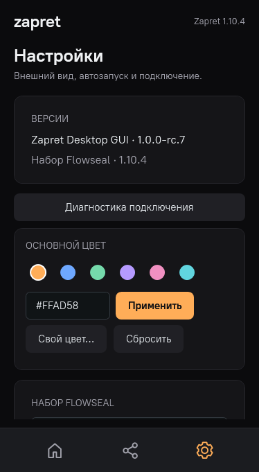

<div align="center">
  
  <h1>Zapret Desktop</h1>
  <p>Простой интерфейс для Zapret и набора стратегий Flowseal</p>
  <p>
    
    
    <a href="LICENSE"></a>
    
  </p>
  <p><a href="https://github.com/trankesh/zapret-youtube-discord-gui/releases">Скачать</a> · <a href="#первый-запуск">Первый запуск</a> · <a href="#как-пользоваться">Инструкция</a> · <a href="#авторы-и-лицензии">Авторы и лицензии</a></p>
</div>

Нативное приложение для Windows, которое помогает выбрать стратегию обхода DPI, проверить доступность сайтов и управлять Zapret без командной строки. Компактное тёмное окно, понятные настройки и автоподбор под ваше подключение.

**Неофициальный проект.** Основа обхода — [zapret от bol-van](https://github.com/bol-van/zapret), набор конфигов — [Flowseal/zapret-discord-youtube](https://github.com/Flowseal/zapret-discord-youtube). Компоновка интерфейса вдохновлена [AmneziaVPN](https://github.com/amnezia-vpn/amnezia-client). GUI разработан отдельно и не является продуктом этих команд.

> Zapret изменяет обработку сетевых пакетов для обхода DPI. Он не создаёт VPN-туннель, не меняет внешний IP и не обеспечивает анонимность.

## Скриншоты

<table>
  <tr>
    <td align="center"><b>Главная</b><br></td>
    <td align="center"><b>Выбор стратегии</b><br></td>
  </tr>
  <tr>
    <td align="center"><b>Автоподбор</b><br></td>
    <td align="center"><b>Настройки</b><br></td>
  </tr>
</table>

Скриншоты получены отрисовкой самого приложения на демонстрационных данных. Они не содержат пользовательских путей или результатов проверки реальной сети.

## Что умеет

- Запуск и остановка выбранной стратегии одной кнопкой.
- Автоподбор среди всех конфигов или только отмеченных вами; проверка текущего подключения, подробности и сохранение отчёта.
- Выдвижной список стратегий с поиском. Его можно открыть свайпом вверх и закрыть свайпом вниз или кликом по шапке; выбор стратегии не закрывает список.
- Игровой режим, диагностика подключения, работа в трее.
- Обновление hosts и IPSet, резервные копии и восстановление hosts.
- Выбор защищённого DNS: Cloudflare, Google, Quad9, AdGuard или OpenDNS; откат изменений.
- Автозапуск интерфейса с Windows без повторного UAC при входе и отдельный запуск обхода через службу.
- Выбор цвета, мастер первого запуска и продвинутые настройки фильтров/списков.
- Уведомление, если выбранный набор удалён или перемещён. Во время автоподбора доступна только отмена, чтобы случайные действия не прервали проверку.

C# / WPF / .NET Framework. Без Electron, Node.js и фонового веб-сервера.

## Скачать

Откройте [Releases](https://github.com/trankesh/zapret-youtube-discord-gui/releases) и выберите нужную версию. Текущая публикация — **1.0.0-rc.7**, предварительный релиз.

| Файл | Для чего |
| --- | --- |
| `Zapret-Desktop-…-win-x64.exe` | Самостоятельная программа. Можно положить на рабочий стол. |
| `Zapret-Desktop-…-win-x64.zip` | Та же программа, инструкции, скриншоты и лицензии. |
| `Zapret-Desktop-…-third-party-sources.zip` | Исходники распространяемых WinDivert/Cygwin и сведения об их происхождении. Для запуска не нужны. |
| `SHA256SUMS.txt` | Контрольные суммы файлов релиза. |

Внешний `config` и установщик для запуска не нужны. EXE пока не подписан сертификатом издателя. Исходный код GUI доступен в этом репозитории; архивы **Source code** на странице релиза содержат его снимок.

## Требования

| Компонент | Требование |
| --- | --- |
| Система | Windows 10 x64 версии 1809 или новее с установленным .NET Framework 4.8; рекомендуется Windows 11 x64. Старые версии Windows, ARM и 32-битная система не поддерживаются этой сборкой GUI. |
| Среда | [.NET Framework 4.8](https://dotnet.microsoft.com/download/dotnet-framework/net48) и системный `curl.exe` для проверок. |
| Права | Учётная запись администратора. Ручной запуск запрашивает UAC; при отказе приложение закрывается. |
| Набор | Полностью распакованный набор Flowseal с `service.bat`, BAT-стратегиями, `bin`, `lists` и `utils/targets.txt`. Проверен и встроен **Flowseal 1.10.4**. Совместимость иных версий зависит от структуры и параметров набора. |
| Папка набора | Доступная для записи. Для внешнего набора рекомендуется короткий путь без кириллицы и специальных символов, например `C:\Zapret`. Не удаляйте эту папку после выбора. |
| Сеть | Интернет для реальных проверок и загрузки обновлений. Работа конкретной стратегии зависит от провайдера, региона и текущих ограничений. |
| Системный DoH | Автоматическая настройка DNS over HTTPS требует поддержки соответствующих команд Windows, обычно Windows 11. Если поддержки нет, доступен гайд для браузера. |

Windows-драйвер WinDivert входит в набор Flowseal. Не запускайте параллельно несколько экземпляров обхода или сторонние менеджеры Zapret. Точные требования новых наборов сверяйте с [их официальной документацией](https://github.com/Flowseal/zapret-discord-youtube#readme). Требования к RAM и CPU отдельно не измерялись.

## Первый запуск

1. Скачайте EXE или распакуйте полный ZIP. Если прежняя версия открыта, полностью выйдите через её значок в трее.
2. Откройте EXE и разрешите запуск от имени администратора.
3. В мастере выберите распакованный набор Flowseal либо нажмите кнопку использования встроенного **1.10.4**. Встроенный набор распаковывается только по вашему выбору.
4. При желании проверьте и обновите **hosts / IPSet**. Перед записью hosts будут показаны изменения; исходный файл сохранится в резервной копии.
5. При желании настройте **защищённый DNS**. Выберите активное подключение Wi-Fi/Ethernet и провайдера, затем подтвердите применение.
6. Откройте главную, выберите стратегию и нажмите **«Подключить»**. Если подходящая стратегия неизвестна — запустите **автоподбор**.

Обязателен только выбор исправного набора. Остальные шаги можно пропустить и выполнить позже в настройках. Переход между шагами сам по себе не меняет DNS и hosts и не скачивает обновления.

## Как пользоваться

### Подключение и стратегии

Нажмите название стратегии в нижней карточке главной страницы. В открывшемся списке выберите конфиг, при необходимости воспользуйтесь поиском. Закройте список кликом по шапке или свайпом вниз. Круглая кнопка запускает или останавливает обход.

Переключатель **«Игровой режим»** меняет обработку игровых подключений; менять его нужно при остановленном обходе. Если после включения игры стали работать хуже, отключите его и подключитесь заново.

### Проверка и автоподбор

1. Откройте **«Автоподбор стратегии»** на главной.
2. Оставьте **«Все»** или нажмите **«Выбрать»** и отметьте нужные стратегии.
3. **«Проверить»** проверяет текущую сеть; **«Подобрать»** последовательно запускает и оценивает стратегии.
4. Дождитесь завершения или нажмите **«Отмена»** / Esc. Во время подбора остальные действия заблокированы до завершения остановки и восстановления подключения.
5. Посмотрите число доступных целей и задержку, затем проверьте нужные сайты и приложения обычным способом. Ни одна стратегия не гарантирует работу у всех провайдеров.

Перед перебором остановите сторонний Zapret и удалите установленную службу обхода через настройки приложения. Отчёт можно сохранить; перед публикацией проверьте его — он может содержать локальные пути и сведения о сети.

### Hosts, IPSet и DNS

В **«Настройки → Hosts и IPSet»** сначала нажмите **«Проверить актуальность»**, затем нужную кнопку обновления. Для IPSet остановите обход. Мини-гайд по hosts и восстановление из копии находятся там же; подробности — в [HOSTS-GUIDE.md](HOSTS-GUIDE.md).

Опция **«Адреса Secure DNS в hosts»** добавляет адреса DNS-провайдеров при следующем обновлении hosts. Эти записи помогают разрешать их имена, но сами не шифруют запросы и не обходят блокировку IP-адресов.

В **«Защищённый DNS»** можно изменить DNS выбранного адаптера и включить DoH, если система поддерживает его. Старые параметры сохраняются перед изменением; есть кнопка отката. При нескольких активных подключениях настройте каждое отдельно. В корпоративной сети публичный DNS может мешать доступу к внутренним доменам.

### Трей и автозапуск

- Двойной щелчок по значку в трее открывает окно. Повторный запуск EXE показывает уже работающий экземпляр.
- ПКМ по значку показывает статус, выбранную стратегию, отключение обхода и полный выход.
- **«Запускать интерфейс с Windows»** создаёт задачу для текущей учётной записи администратора. Windows запускает защищённую копию EXE с повышенными правами, без повторного запроса UAC при входе.
- **«Запускать свёрнутым»** сразу скрывает окно в трей.
- **«Запускать обход с Windows»** использует отдельную службу: она может работать без открытого GUI. Закрытие GUI не останавливает такую службу.

После замены EXE откройте новую версию вручную с UAC: включённый автозапуск обновится. Ручной запуск по-прежнему требует повышения прав.

### Продвинутый режим

Включается внизу настроек. Открывает фильтры, списки, дополнительные тесты Flowseal и управление службой. Диагностика доступна и без него. Правьте фильтры при остановленном обходе; после изменения параметров существующую службу нужно переустановить.

## Данные и перенос программы

Настройки, журнал, результаты, встроенные наборы и резервные копии хранятся в **`%LocalAppData%\ZapretDesktop`**, а не рядом с EXE. Папку можно открыть из настроек. Перемещение EXE не сбрасывает профиль.

Для профиля на флешке создайте рядом с EXE пустой файл `portable.mode`: тогда используется соседняя папка `data`, которую нужно переносить вместе с программой. Переход со старой папки `data` описан в [INSTALL.md](INSTALL.md).

В поставку не включены пользовательские настройки, логи, отчёты, резервные копии hosts/DNS или пути к папкам разработчика. Приложение не отправляет журнал и настройки на сервер проекта. Сетевые действия нужны для проверки целей и получения обновлений с upstream GitHub; DNS-запросы обрабатывает выбранный вами DNS-провайдер.

## Если не работает

| Проблема | Что проверить |
| --- | --- |
| Сайты не открываются | Другая стратегия, актуальность hosts/IPSet, защищённый DNS. Затем диагностика в настройках. |
| Набор перемещён или удалён | Выберите его новое расположение в появившемся мастере или используйте встроенный набор. |
| Перебор не запускается | Остановите внешний `winws` и удалите установленную службу обхода. |
| Открылся старый интерфейс | Полностью выйдите через трей, затем запустите новый EXE. |
| Нельзя применить DNS | Проверьте поддержку DoH в системе; используйте предлагаемый гайд для браузера. |
| Вопрос про сам GUI | Создайте [Issue](https://github.com/trankesh/zapret-youtube-discord-gui/issues) с версией GUI/набора и описанием. Удалите личные данные из отчётов и скриншотов. |

## Авторы и лицензии

| Проект / компонент | Автор / команда | Лицензия и роль |
| --- | --- | --- |
| Zapret Desktop | Участники этого репозитория | [MIT](LICENSE) — собственный код GUI. |
| [zapret / winws](https://github.com/bol-van/zapret), [Windows bundle](https://github.com/bol-van/zapret-win-bundle) | **bol-van** и участники | MIT — движок обхода DPI. |
| [zapret-discord-youtube](https://github.com/Flowseal/zapret-discord-youtube) | **Flowseal**, bol-van и участники | [MIT](assets/bundle/LICENSE-Flowseal.txt) — набор конфигов и BAT-инструменты; встроен оригинальный архив 1.10.4. |
| [WinDivert](https://github.com/basil00/WinDivert) | **basil00** и участники | LGPLv3 или GPLv2 по выбору; тексты в [licenses/WinDivert-LICENSE.txt](licenses/WinDivert-LICENSE.txt). Перехват пакетов Windows. |
| [Cygwin](https://cygwin.com/) | Red Hat и участники Cygwin | LGPLv3+ с [Cygwin linking exception](licenses/Cygwin-linking-exception.txt). Библиотека среды для `winws`. |
| [PT Root UI](https://www.paratype.com/fonts/pt/pt-root-ui) | **Paratype** | [SIL Open Font License 1.1](assets/fonts/OFL.txt); шрифт интерфейса, Reserved Font Name: PT Root UI. |
| [AmneziaVPN](https://github.com/amnezia-vpn/amnezia-client) | **Amnezia Team** и участники | Визуальное вдохновение. Клиент Amnezia распространяется по GPL-3.0; его исходный код, логотип и графические файлы в GUI не включены. |

Спасибо авторам исходного Zapret, Flowseal и Amnezia за их работу. Имена проектов используются для указания совместимости и авторства; официальная связь или одобрение не заявляются. Лицензия MIT GUI не заменяет лицензии сторонних компонентов.

Полный состав, тексты лицензий, ссылки на исходники и сведения о бинарных файлах: [THIRD-PARTY-NOTICES.md](THIRD-PARTY-NOTICES.md), [licenses/](licenses/), [происхождение встроенного набора](assets/bundle/NOTICE.md).

## Сборка из исходников

В Windows x64 с .NET Framework 4.8:

```powershell
powershell -NoProfile -ExecutionPolicy Bypass -File .\build.ps1
```

Готовый EXE появится в `build\Zapret.exe`. Используется системный компилятор .NET Framework; устанавливать npm или отдельный .NET SDK не нужно.

Сборка релиза с автоматическими проверками:

```powershell
powershell -NoProfile -ExecutionPolicy Bypass -File .\release.ps1 -RunNetworkTests
```

Проверки работают на временных данных и локальных HTTP-ответах, не устанавливают службу и не меняют системные hosts, DNS или автозапуск. Полные детали разработки — [docs/DEVELOPMENT.md](docs/DEVELOPMENT.md), порядок выпуска — [RELEASE.md](RELEASE.md), участие — [CONTRIBUTING.md](CONTRIBUTING.md).
